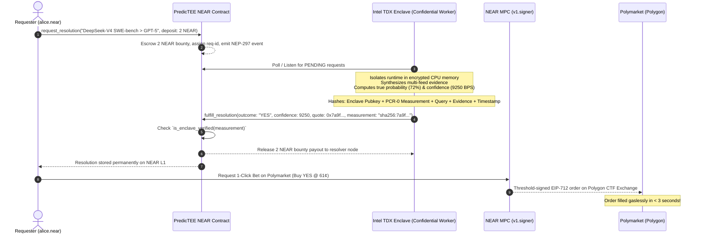

# 🔮 PredicTEE

> **Verifiable TEE AI Oracle & Omnichain Autonomous Execution on NEAR**  
> *Hardware-Attested Intelligence (Intel TDX / NVIDIA TEE) & Zero-Bridge Settlement (NEAR Chain Signatures MPC)*

[](https://near.org)
[](https://near.ai)
[](https://near.org)
[](https://intel.com)
[](https://docs.near.org/abstraction/chain-signatures)
[](https://nomicon.io/Standards/EventsFormat)
[](LICENSE)

---

## 📌 Executive Summary

Modern prediction markets like **Polymarket** (on Polygon) and **Kalshi** have emerged as the world's most accurate real-time truth engines, processing billions of dollars in speculative and hedging volume. However, the decentralized prediction and oracle landscape is crippled by two structural bottlenecks:

1. **The Subjective Resolution Crisis**: Traditional numeric oracles (Chainlink) cannot parse nuanced, unstructured qualitative questions (e.g., *"Did DeepSeek-V4 outperform GPT-5 on SWE-bench?"*, *"Will the Fed pivot in December 2026?"*). Optimistic human-voting oracles (UMA) suffer from sluggish 2-hour to 7-day dispute windows, governance voter apathy, and cartel bribery vulnerabilities. Meanwhile, unverified AI oracles are untrusted blackboxes whose weights, prompts, and host servers can be silently manipulated by cloud operators.
2. **Cross-Chain Capital & Execution Silos**: Users must bridge USDC to secondary L2s, hold isolated gas tokens (POL/MATIC), and manually execute trades without continuous confidential alpha synthesis.

**PredicTEE** solves this end-to-end by marrying **Confidential Computing (Intel TDX / NVIDIA TEE)** with **NEAR Chain Signatures (MPC)**:
- 🛡️ **Verifiable Hardware-Signed AI Oracle**: AI multi-source synthesis runs exclusively inside an isolated **Intel TDX Enclave**. Every resolution outputs a cryptographic quote with a **PCR-0 code measurement** verified directly by the NEAR Smart Contract. Rogue models or spoofed hardware are mathematically rejected on-chain.
- 💰 **Economic Request-Fulfill Escrow**: Any smart contract, DAO, or prediction market can query the oracle with an attached yoctoNEAR bounty. The first verified enclave to fulfill receives the bounty, optionally triggering on-chain callback dispatch.
- ⚡ **Omnichain 1-Click Execution via NEAR MPC**: A single native NEAR account (`alice.near`) derives an EVM address on Polygon and signs EIP-712 orders on Polymarket without bridging assets or managing gas tokens.

---

## 🥊 Problem vs. PredicTEE

| Oracle / Architecture | Resolution Speed | Subjective / Complex Events | Trust Model | Frontrunning & Alpha Leakage | Cross-Chain Execution |
| :--- | :--- | :--- | :--- | :--- | :--- |
| **Traditional Oracles (Chainlink)** | Fast (< 1 min) | ❌ Incompatible (Numeric/Price feeds only) | Multisig Node Signatures | High (Public mempool) | Network-Specific Bridges Required |
| **Optimistic Oracles (UMA)** | 2 Hours – 7 Days | ⚠️ Slow & expensive human voting | Economic Game Theory / Token Whales | High (Voter collusion risk) | L2 Fragmented |
| **Naive Web2 AI Oracles** | Fast (1–5s) | ✅ LLM qualitative synthesis | ❌ Complete Blackbox (Cloud/Host manipulation) | Extreme (Prompts & logs exposed) | Manual User Setup |
| **🔮 PredicTEE (NEAR TEE)** | **Sub-Second to 3s** | **✅ Deep Multi-Source Synthesis** | **🛡️ Hardware Cryptographic Attestation (Intel TDX)** | **🔒 Zero-Knowledge Enclave Isolation** | **⚡ 1-Click NEAR MPC (Polymarket)** |

---

## 🏗️ System Architecture

PredicTEE consists of three unified architectural layers:

```mermaid
flowchart TD
    subgraph Layer1 ["1. Client & Smart Contract Request Layer (NEAR L1)"]
        User["👤 dApp / DAO / Alice.near"] -->|"1. request_resolution(query, bounty)"| Contract["📜 PredicTEE Smart Contract (NEAR L1)"]
        Contract -->|"2. Emits NEP-297 oracle_request_created"| EventHub["📡 On-Chain Event Stream"]
    end

    subgraph Layer2 ["2. Confidential AI Worker (Intel TDX / NEAR AI Cloud)"]
        EventHub -->|"3. Ingests Pending Query"| Enclave["🛡️ Intel TDX Hardware Enclave"]
        subgraph Enclave_Boundary ["Encrypted Memory Enclave (Zero-Knowledge Isolation)"]
            Feed1["📊 Financial Curves & Orderbooks"] --> AI["🧠 DeepSeek-V3 / Llama-3.3 Reasoning"]
            Feed2["📰 Multi-Source News Feeds"] --> AI
            Feed3["📈 On-Chain Whale Flow"] --> AI
            AI -->|"Calculates Outcome & Confidence BPS"| Reasoner["⚖️ Synthesized Resolution"]
            Reasoner -->|"Hardware Hardware Measurement (PCR-0)"| QuoteGen["🔏 Intel TDX Attestation Quote"]
        end
    end

    subgraph Layer3 ["3. On-Chain Settlement & Cross-Chain Execution"]
        QuoteGen -->|"4. fulfill_resolution(attestation_hash, measurement)"| Contract
        Contract -->|"5. Verifies Enclave Measurement against Whitelist"| Verifier{"Is Measurement Whitelisted?"}
        Verifier -- "No" --> Reject["❌ Reject Transaction (Revert)"]
        Verifier -- "Yes" --> Settle["✅ State -> RESOLVED + Bounty Paid to Resolver"]
        Settle -->|"Optional Callback Dispatch"| Consumer["🏛️ Consumer dApp / Resolution Vault"]
        Settle -->|"6. Trigger Cross-Chain Bet Intent"| MPC["🔐 NEAR MPC Network (v1.signer)"]
        MPC -->|"7. Derives Polygon Address & Signs EIP-712 Order"| PolyMarket["⚡ Polymarket CTF Exchange (Polygon)"]
    end

    style Enclave_Boundary fill:#0d1b2a,stroke:#00ec97,stroke-width:2px;
    style Verifier fill:#1e293b,stroke:#38bdf8,stroke-width:2px;
    style Settle fill:#064e3b,stroke:#10b981,stroke-width:2px;
```



---

### 🛡️ Hardware Enclave Attestation & Security Workflow



---

## 🌟 Key Innovations

### 1. Hardware-Enforced Cryptographic Whitelist
Unlike off-chain oracles that rely on centralized API keys or subjective voting rounds, the PredicTEE smart contract stores a cryptographically validated whitelist of **Intel TDX and NVIDIA Confidential GPU enclave measurements (PCR-0)**:
- `sha256:7a9f82d1c6b3e4018274a5e01f2d8b4c91a03e5f2b8d1a4c9e3b7a1f5d2c8e0` (NEAR AI Cloud Intel TDX Enclave v1.0)
- `sha256:8b1e45f92a3c7d60e145b2f8a9c3d4e5f60718293a4b5c6d7e8f9a0b1c2d3e4f` (NVIDIA H100 Confidential GPU Cluster)
- `sha256:4d6f8a2e1c3b5a790f8e2d4b6a8c0e1f3a5b7c9d1e3f5a7b9c1d3e5f7a9b1c3d` (Phala / Dstack Attested Node)

If an unverified node or an adversary attempting prompt injection attempts to call `fulfill_resolution`, the contract immediately rejects the execution on-chain.

### 2. Standardized NEP-297 Event Architecture
The contract strictly follows the **NEAR NEP-297 Event Standard**, enabling instant indexing by The Graph, SubQuery, Fast NEAR RPC, or real-time WebSockets:
- `oracle_request_created`: Emits request ID, requester, query, category, attached bounty, and timestamp.
- `oracle_request_fulfilled`: Emits outcome, confidence BPS, resolver ID, attestation quote hash, and bounty settlement.
- `oracle_request_cancelled`: Emits refund confirmation to the original requester.

### 3. Alpha Divergence Metric (+EV Discovery)
PredicTEE compares the **Live Polymarket Implied Probability** against the **Confidential AI True Probability**:
$$\text{Alpha Divergence} = P_{\text{TEE True}} - P_{\text{Market Implied}}$$
When positive EV ($+\text{EV}$) is detected, users can capitalize on mispriced prediction books with a single click.

### 4. Zero-Bridge Omnichain Execution (NEAR Chain Signatures)
Through NEAR's `v1.signer` MPC network:
$$\text{Polygon Address} = \text{Derive}(\text{alice.near}, \text{path} = \text{"polymarket"}, \text{contract} = \text{"v1.signer"})$$
Users place limit orders on Polygon's Conditional Token Framework (CTF) exchange without ever holding MATIC or switching wallet networks.

---

## 📜 Smart Contract Reference (`packages/contracts`)

The core contract is built with `near-sdk-js` and tested on NEAR testnet / local simulation harnesses.

### Write Methods (Calls)

#### `request_resolution`
Submits a resolution query to the decentralized TEE oracle network.
- **Payable**: Requires non-zero yoctoNEAR deposit as resolver bounty.
- **Parameters**:
  - `query` (`string`): The qualitative resolution query (e.g., *"Did SpaceX Starship complete orbital insertion?"*).
  - `category` (`string`, optional): Domain category (`"Crypto"`, `"Macro & Fed"`, `"AI Benchmarks"`, `"Politics"`).
  - `callback_contract` (`string`, optional): Consumer contract ID to be notified upon resolution.
  - `callback_method` (`string`, optional): Method to execute on the callback contract.
- **Returns**: `requestId` (`string`, e.g., `"req-1"`).

#### `fulfill_resolution`
Invoked by an attested TEE Enclave node to resolve a pending query.
- **Parameters**:
  - `request_id` (`string`): Target request identifier.
  - `outcome` (`string`): Synthesized outcome (`"YES"`, `"NO"`, or formatted value).
  - `confidence_bps` (`number`): Resolution confidence in basis points ($0 - 10000$, where $10000 = 100\%$).
  - `attestation_hash` (`string`): Hardware quote cryptographic signature.
  - `enclave_measurement` (`string`): Enclave PCR-0 code SHA-256 fingerprint.
  - `evidence_digest` (`string`, optional): SHA-256 digest of input sources used in reasoning.
- **Behavior**: Validates measurement against whitelist, transitions status to `RESOLVED`, releases yoctoNEAR bounty to resolver, dispatches callback (if configured), and emits NEP-297 event.

#### `cancel_request`
Allows the original requester or contract owner to cancel a `PENDING` request and refund the attached bounty.
- **Parameters**: `request_id` (`string`).

#### `register_tee_enclave` *(Owner Only)*
Adds a new authorized hardware enclave measurement to the whitelist.
- **Parameters**: `measurement` (`string`), `label` (`string`).

#### `deactivate_tee_enclave` *(Owner Only)*
Revokes fulfillment privileges from an enclave measurement.
- **Parameters**: `measurement` (`string`).

---

### Read Methods (Views)

| View Method | Arguments | Return Type | Description |
| :--- | :--- | :--- | :--- |
| `get_request` | `request_id: string` | `OracleRequest \| null` | Fetches details and status of an oracle query |
| `get_resolution` | `request_id: string` | `OracleResolution \| null` | Retrieves hardware quote and outcome for resolved query |
| `list_requests` | `from_index?: number, limit?: number, status?: string` | `OracleRequest[]` | Paginated list with status filter (`PENDING`, `RESOLVED`, `CANCELLED`) |
| `get_stats` | *none* | `OracleStats` | Global stats (total requests, bounties paid, active enclaves) |
| `is_enclave_verified` | `measurement: string` | `boolean` | Verifies whether a hardware enclave measurement is whitelisted |
| `list_enclaves` | *none* | `EnclaveInfo[]` | Returns all registered TEE enclaves and their statuses |

---

## ⚡ Agent REST API Reference (`packages/agent`)

The Python Confidential Worker runs FastAPI inside the enclave boundary at `http://127.0.0.1:8000`.

- `GET /api/health`  
  Returns hardware node health, active TEE mode (Intel TDX / NVIDIA CC), and MPC signer status.
- `GET /api/markets`  
  Fetches live Polymarket orderbooks enriched with TEE confidential AI probability assessments and PCR-0 quotes.
- `GET /api/market/{id}`  
  Returns deep analysis, multi-feed weights, and cryptographic quotes for a specific market.
- `POST /api/intent/create`  
  Prepares a cross-chain order payload and EIP-712 digest tied to the NEAR account.
- `POST /api/intent/execute`  
  Simulates or broadcasts the NEAR MPC threshold signature (`v1.signer`) to Polygon CTF Exchange.

---

## 📂 Project Repository Structure

```
predictee/
├── packages/
│   ├── contracts/                     # NEAR Smart Contracts
│   │   ├── src/
│   │   │   └── index.ts               # Standard Request-Fulfill Oracle & Whitelist Enforcer
│   │   ├── test/
│   │   │   └── simulate.js            # Comprehensive 8-Stage Contract Simulation Suite
│   │   ├── tsconfig.json
│   │   └── package.json
│   ├── agent/                         # Confidential AI Worker & TEE Engine
│   │   ├── agent.py                   # FastAPI Hub & Live Polymarket Ingestion
│   │   ├── tee_engine.py              # Intel TDX Hardware Attestation Quote Generator
│   │   ├── chain_sig.py               # NEAR Chain Signatures MPC Derivation Service
│   │   └── requirements.txt
│   └── frontend/                      # Web Dashboard & Oracle Explorer
│       ├── src/
│       │   ├── App.tsx                # Interactive UI: TEE Inspector, Market Cards & 1-Click Bet
│       │   ├── App.css
│       │   └── main.tsx
│       ├── vite.config.ts
│       └── package.json
├── package.json                       # Monorepo Workspace Configuration
├── DEMO_GUIDE.md                      # Judge Video Pitch Script & 6-Step Click-Through Guide
├── start.bat                          # Unified 1-Click Launch Script (Windows)
└── README.md
```

---

## 🚀 Quickstart Guide

### Prerequisites
- **Node.js**: v18+ (v20+ recommended)
- **Python**: 3.10+
- **Git**

### 1-Click Unified Launch (Windows)
Double-click `start.bat` in the root directory or run:
```cmd
start.bat
```
This automatically verifies contract tests, starts the Confidential Agent backend at `http://127.0.0.1:8000`, and launches the React dashboard at `http://localhost:5173`.

---

### Manual Step-by-Step Setup

#### Step 1: Verify the NEAR Smart Contract
```bash
# From repository root
npm run contracts:test
```
*Executes all 8 simulation test suites:*
1. Contract Initialization and Owner setup
2. Enclave Whitelist Management & Access Control
3. Oracle Request Creation with attached Deposit (Bounty)
4. TEE Attestation & Measurement Enforcement (Rejecting unverified hardware)
5. Legitimate TEE Fulfillment & Bounty Release
6. Request Cancellation & Deposit Refund
7. Paginated Views, Filter Queries, and Global Stats
8. Backward-Compatible Intent Registry & NEP-297 Event Audit

#### Step 2: Start the Confidential AI Agent Service
```bash
cd packages/agent
pip install -r requirements.txt
python agent.py
```
*API running at `http://127.0.0.1:8000` (Interactive docs at `http://127.0.0.1:8000/docs`).*

#### Step 3: Launch the Frontend Web Dashboard
```bash
cd packages/frontend
npm install
npm run dev
```
*Open `http://localhost:5173` in your browser.*

---

## 🏆 Hackathon Alignment & Judging Criteria

### 🔒 Track 1: Privacy & Private AI (Primary)
- **Enclave Memory Isolation**: Proprietary trading strategies, sensitive query prompts, and confidential data feeds are processed entirely in encrypted memory using **Intel TDX / NVIDIA Confidential Computing**.
- **Cryptographic PCR-0 Quote Attestation**: Every AI resolution carries an immutable cryptographic hardware signature and code measurement that is strictly verified on-chain by the NEAR smart contract.
- **Zero Prompt Leaks**: Prevents cloud operators, node runners, and network searchers from sniffing queries or frontrunning high-alpha predictions.

### 🤖 Track 2: Agent Economy & Unstoppable DeFi
- **Autonomous Economic Workers**: AI agents inside TEEs monitor on-chain oracle requests, resolve qualitative queries, and collect yoctoNEAR bounties autonomously.
- **Cross-Chain Chain Signatures (MPC)**: Unlocks the full power of NEAR as the universal intent layer. A NEAR user seamlessly trades and settles on Ethereum/Polygon prediction markets without bridging funds or managing secondary gas tokens.

---

## 🗺️ Roadmap & Future Milestones

- [x] **Phase 1**: NEAR Request-Fulfill Oracle Smart Contract with Intel TDX Enclave Whitelist enforcement.
- [x] **Phase 2**: NEP-297 standardized event logging with automated bounty escrow.
- [x] **Phase 3**: Confidential AI Worker with Intel TDX PCR-0 quotes and multi-source evidence synthesis.
- [x] **Phase 4**: NEAR Chain Signatures MPC integration for 1-click Polymarket execution.
- [ ] **Phase 5**: Multi-Enclave Consensus Quorum (Requiring $M$-of-$N$ distinct TEE vendors: Intel TDX + AMD SEV-SNP + NVIDIA CC before contract resolution).
- [ ] **Phase 6**: Decentralized Resolver Staking & Slashing for malicious hardware key compromise.

---

## 👥 PredicTEE Team

Developed with ❤️ for the **NEAR Hackathon 2026**.

- **Product & Architecture**: Verifiable TEE AI Oracle & Omnichain Prediction Infrastructure.
- **Core Stack**: NEAR Protocol, NEAR AI Cloud, Intel TDX, NEAR Chain Signatures (`v1.signer`), FastAPI, React, TailwindCSS.

## 📄 License
This repository is licensed under the [MIT License](LICENSE).
