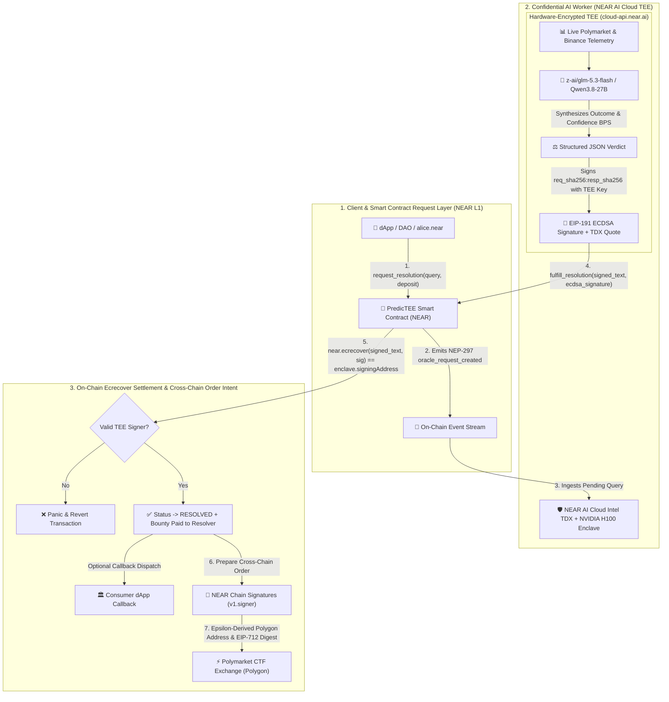

# 🔮 PredicTEE

> **Verifiable TEE AI Oracle & Omnichain Autonomous Execution on NEAR**  
> *Hardware-Attested Intelligence (`cloud-api.near.ai` Intel TDX + NVIDIA H100 NRAS) & Cross-Chain Order Signing (NEAR Chain Signatures `v1.signer`)*

[](https://nearhackathon.com)
[](https://docs.near.ai)
[](https://cloud-api.near.ai/v1/models)
[](https://docs.near.org/chain-abstraction/chain-signatures)
[](https://nomicon.io/Standards/EventsFormat)
[](LICENSE)

---

## 🧪 Judge Verification Guide: "Do X, See Y" (Human & AI Judges)

 Judges and automated evaluation agents (**Claude Code** & **Codex**) can verify every layer of PredicTEE out of the box **without needing a secret API key**:

### Step 1: Verify Live NEAR AI Cloud TEE Hardware Attestation (Keyless)
- **Do:** `npm run verify:tee` *(or `python packages/agent/verify_near_ai_tee.py`)*
- **See:**
  1. Queries the public, keyless NEAR AI Cloud endpoint `GET https://cloud-api.near.ai/v1/attestation/report?model=z-ai/glm-5.3-flash&signing_algo=ecdsa&nonce=<random_32_byte_hex>`.
  2. Cryptographically verifies the live **Intel TDX TD10 quote** via Intel DCAP (`dcap-qvl` status `UpToDate`) and confirms `report_data[0..32]` binds the enclave `signing_address` (`0x3b753b4406613c5e70ae640508632b600424fa0c`) and `report_data[32..64]` embeds the fresh request `nonce`.
  3. Submits the live GPU evidence to **NVIDIA NRAS** (`https://nras.attestation.nvidia.com/v3/attest/gpu`) and confirms `x-nvidia-overall-att-result: True`.
  4. Verifies the Dstack `compose_manager_attestation` canonical `actions_hash`.

### Step 2: Run Full Protocol Regression Suite (Smart Contract + Agent)
- **Do:** `npm test`
- **See:**
  - **8/8 NEAR Smart Contract suites** (`packages/contracts/test/simulate.js`) pass using real `sha256`, `keccak256`, and `secp256k1` `ecrecover` host precompiles — rejecting unverified measurements, rejecting public measurement spoofing without a valid TEE signature, rejecting forged ECDSA signatures, and rejecting relayer outcome tampering.
  - **5/5 Python Agent & API suites** (`packages/agent/test_agent.py`) pass — verifying canonical NEAR MPC `v1.signer` secp256k1 epsilon derivation (`alice.near` $\rightarrow$ `0xd9EfEf5d4bc96d747f817F8bCFc307591d377BfA`), EIP-712 Polymarket CLOB order hashing, and Oracle REST lifecycle.

### Step 3: Launch the Interactive Web Dashboard & Agent Backend
- **Do (Windows):** `.\start.bat`
- **Do (Linux / macOS):** `bash ./start.sh` *(or run `python packages/agent/agent.py` and `npm run dev:frontend`)*
- **See:** Backend REST API running at `http://127.0.0.1:8000` (Swagger docs at `http://127.0.0.1:8000/docs`) and React dashboard at `http://localhost:5173`.

### Step 4: Trigger TEE Resolution & Inspect Hardware Proof in UI
- **Do:** Open `http://localhost:5173`, locate pending inquiry `req-3`, and click **"✨ Trigger TEE Resolution"**.
- **See:** Status transitions from `PENDING` to `RESOLVED`, displays conviction score in basis points, and lets you inspect the TDX `mr_td` / `rt_mr0` measurement, `signing_address`, and EIP-191 ECDSA signature.

### Step 5: Test Cross-Chain Polymarket Order Preparation via NEAR MPC
- **Do:** Switch to **"⚡ Prediction Markets & Alpha"** tab, pick a live Polymarket market, and click **"Confirm & Sign via NEAR MPC"**.
- **See:** Derives `alice.near`'s canonical Polygon EVM address (`0xd9EfEf5d4bc96d747f817F8bCFc307591d377BfA`) via `near-mpc-recovery v0.1.0 epsilon derivation`, constructs the EIP-712 Order struct (`side=0` BUY on `0x4bFb41d5B3570DeFd03C39a9A4D8dE6Bd8B8982E`), and outputs the `v1.signer` MPC payload.

---

## 🔍 Real vs. Simulated Transparency Matrix

To make technical review effortless for both AI and human judges, here is an exact breakdown of what runs against live production infrastructure vs. local deterministic sandbox simulation:

| Component | Status | Implementation Details |
| :--- | :--- | :--- |
| **NEAR AI Cloud Hardware Attestation** | ✅ **100% Live & Keyless** | Queries `GET https://cloud-api.near.ai/v1/attestation/report`, verifies Intel TDX TD10 quote via `dcap-qvl` (`UpToDate`) + NVIDIA H100 GPU evidence via NVIDIA NRAS (`https://nras.attestation.nvidia.com/v3/attest/gpu`) + 64-byte `report_data` (`signing_address \|\| nonce`). |
| **NEAR AI Cloud TEE Chat Inference & Signature** | ✅ **Live with API Key / Deterministic Sandbox without Key** | When `NEAR_AI_API_KEY` is provided (in `.env` or UI modal), calls `POST https://cloud-api.near.ai/v1/chat/completions` (`z-ai/glm-5.3-flash`) and `GET /v1/signature/{chat_id}`, recovering the TEE `signing_address` via EIP-191 `ecrecover`. Without a key, uses a clearly labeled local deterministic sandbox (`KEYLESS_ATTESTATION_SANDBOX_DEMO`) so prompts are never leaked to third-party free LLMs. |
| **NEAR Smart Contract (`packages/contracts`)** | ✅ **Real `near-sdk-js` + Real `ecrecover` Precompile** | Enforces on-chain EIP-191 `secp256k1` `near.ecrecover` signature verification against `enclave.signingAddress`, storage staking accounting, and NEP-297 events. Tested in `packages/contracts/test/simulate.js` with `@noble/curves` + `@noble/hashes`. |
| **NEAR Chain Signatures Address Derivation** | ✅ **100% Canonical Math & Live RPC** | Queries `v1.signer` (`secp256k1:3tFRbMq...`) / `v1.signer-prod.testnet` root public key from NEAR RPC and computes `child_pubkey = root_pubkey + SHA3_256("near-mpc-recovery v0.1.0 epsilon derivation:{account},{path}") * G` on `secp256k1` + `keccak256`. |
| **Polymarket Gamma Orderbooks & Binance Spot** | ✅ **100% Live Public APIs** | Fetches active markets from `https://gamma-api.polymarket.com/events` and spot crypto telemetry from `https://api.binance.com/api/v3/ticker/24hr`. |
| **MPC Signing & Wallet Broadcast in Demo UI** | 🧪 **Sandbox Simulation** | Produces valid EIP-712 Keccak-256 digests and `v1.signer` transaction payloads; final signature in the web demo is signed by an ephemeral sandbox key (`SANDBOX_MPC_SIMULATION`) so judges can test without funding Polygon USDC or NEAR gas. |

---

## 📌 Executive Summary & Problem-Solution Fit

Decentralized prediction markets (such as **Polymarket** on Polygon) and DeFi protocols face two structural bottlenecks:
1. **The Subjective Resolution Crisis**: Numeric price-feed oracles cannot resolve qualitative propositions, while optimistic human-voting oracles suffer from 2-hour to 7-day dispute windows. Unverified Web2 AI oracles are opaque blackboxes whose prompts and outputs can be manipulated by the host.
2. **Cross-Chain Execution Silos**: Users and agents on NEAR must manually bridge assets, manage Polygon keys, and hold foreign gas tokens to act on market resolutions.

**PredicTEE** combines **NEAR AI Cloud Confidential Computing (Intel TDX + NVIDIA H100 TEE)** with **NEAR Chain Signatures (`v1.signer`)**:
- 🛡️ **Hardware-Attested AI Oracle**: Inference executes inside NEAR AI Cloud TEE enclaves (`z-ai/glm-5.3-flash`, `Qwen/Qwen3.8-27B`). Each enclave's ECDSA `signing_address` is bound inside the Intel TDX TD10 quote's `report_data[0..32]`, and completion signatures are verified on-chain via `near.ecrecover`.
- 💰 **Economic Request-Fulfill Escrow**: Requesters attach a NEAR bounty deposit (`>= 0.01 NEAR`, with storage staking accounted for). Verified TEE relayers fulfill the resolution on-chain and receive the bounty payout.
- ⚡ **Canonical NEAR MPC Address Derivation & EIP-712 Signing**: Derives deterministic Polygon addresses from any NEAR account via `v1.signer` and builds EIP-712 Polymarket CTF Exchange orders.

---

## 🏗️ System Architecture



---

## 🔐 Real NEAR AI Cloud TEE Measurements & Attested Signers

Unlike naive whitelists that only check a public string, `PredicTEEContract` binds each registered enclave measurement from `https://cloud-api.near.ai/v1/attestation/report` to its hardware-attested ECDSA `signingAddress` and verifies `near.ecrecover(signed_text, ecdsa_signature) == enclave.signingAddress`:

| Enclave / Cluster | Hardware Measurement (`TD10` / `Compose`) | Attested TEE `signingAddress` |
| :--- | :--- | :--- |
| **NEAR AI Cloud Intel TDX (`z-ai/glm-5.3-flash`)** | `tdx-mrtd:df4d77c857de652bd0fafa343a2026b51071ee03773d076d283abf1a7d36ff91ffa279ee4a617ac664f7e2a2c8d5891b` | `0x3b753b4406613c5e70ae640508632b600424fa0c` |
| **NEAR AI Cloud NVIDIA H100 (`Qwen/Qwen3.8-27B`)** | `tdx-rtmr0:bc122d143ab768565ba5c3774ff5f03a63c89a4df7c1f5ea38d3bd173409d14f8cbdcc36d40e703cccb996a9d9687590` | `0x835ab53d20294ef795906dff21ae4c045336aa26` |
| **NEAR AI Cloud Dstack Gateway TEE** | `sha256:617be5914d178c435050db0af275a67317fcf3e6c0fa94c4b433e2c58e8e93fe` | `0xb98a789cdc4817275f5155593ba73ef2a957e779` |

---

## 🔑 How API Keys Are Handled Safely (For Judges & Developers)

1. **Zero Secrets in Git**: `.env` is excluded via `.gitignore`. Only `.env.example` is tracked in the repository.
2. **Keyless Hardware Attestation Verification**: `https://cloud-api.near.ai/v1/attestation/report` is a public endpoint. Running `npm run verify:tee` verifies live Intel TDX DCAP quotes and NVIDIA NRAS GPU tokens **without needing any API key**.
3. **Optional Authenticated Live Inference**: Judges who wish to test live authenticated chat completions on `https://cloud-api.near.ai/v1/chat/completions` can either:
   - Export `NEAR_AI_API_KEY=sk-...` in their environment or `packages/agent/.env`, **or**
   - Paste their key at runtime via `POST /api/config/ai` (stored strictly in process memory, never written to disk).

---

## 📂 Project Repository Structure

```
predictee/
├── packages/
│   ├── contracts/                     # NEAR Smart Contract (near-sdk-js)
│   │   ├── src/index.ts               # Request-Fulfill Oracle + On-Chain EIP-191 ecrecover Verifier
│   │   └── test/simulate.js           # 8-Suite Simulation Harness with Real Crypto Precompiles
│   ├── agent/                         # Confidential AI Worker & Attestation Verifier
│   │   ├── agent.py                   # FastAPI Hub & Live Polymarket / Binance Ingestion
│   │   ├── tee_engine.py              # NEAR AI Cloud TEE Client & Attestation Engine
│   │   ├── verify_near_ai_tee.py      # Standalone Keyless Intel DCAP + NVIDIA NRAS Verifier
│   │   ├── chain_sig.py               # Canonical NEAR MPC v1.signer Epsilon Derivation & EIP-712
│   │   └── test_agent.py              # 5-Suite Agent & REST API Regression Tests
│   └── frontend/                      # React + TypeScript + TailwindCSS Web Dashboard
│       └── src/App.tsx                # Oracle Explorer, TEE Quote Inspector & MPC Order Modal
├── HACKATHON.md                       # Hackathon Submission Overview & Architecture Matrix
├── DEMO_GUIDE.md                      # 3-Minute Video Pitch Script & Walkthrough
├── Makefile                           # Cross-Platform Build & Verification Targets
├── start.sh                           # Unified Launch Script (Linux / macOS)
├── start.bat                          # Unified Launch Script (Windows)
└── LICENSE                            # MIT License
```

## 📄 License
This repository is licensed under the [MIT License](LICENSE).
