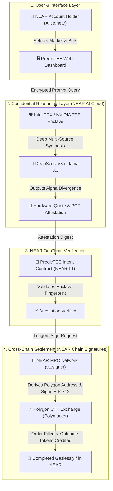

# 🔮 PredicTEE
> **Confidential AI Agent for Cross-Chain Prediction Markets**  
> *Powered by NEAR AI Cloud (TEE) & NEAR Chain Signatures (MPC)*

[](https://near.org)
[](https://dapp.ing)
[](https://dapp.ing)
[](https://near.ai)

---

## 📌 Executive Summary

Prediction markets like **Polymarket** (on Polygon) have exploded into the world's most accurate real-time truth engines. However, decentralized prediction markets face three critical friction points:

1. **Alpha Leakage & Privacy Risks**: Traditional trading bots and AI assistants expose their reasoning, prompts, and strategies to centralized cloud providers (AWS/Azure) or frontrunning searchers.
2. **Cross-Chain Capital Silos**: Users must bridge USDC/POL to Polygon, hold multiple gas tokens, and manage isolated keys.
3. **Execution Gap**: Traders cannot continuously analyze multi-source probability shifts 24/7 or execute automated dynamic risk management.

**PredicTEE** solves this by unifying **NEAR AI Cloud's Confidential Computing (TEE)** with **NEAR Chain Signatures (MPC)**:
- 🛡️ **Zero-Knowledge Hardware Privacy**: AI market synthesis runs exclusively inside **Intel TDX / NVIDIA TEE** enclaves. Every probability forecast returns an immutable **cryptographic hardware attestation (Quote)**.
- ⚡ **Omnichain 1-Click Execution**: Users bet directly using their **native NEAR account**. NEAR MPC nodes sign and broadcast the conditional token order directly to **Polymarket on Polygon**.
- 🤖 **Autonomous Risk Agent**: The agent continuously compares market odds with TEE true probabilities, executing automatic hedge and stop-loss intents.

---

## 🏗️ System Architecture



---

## 🚀 Key Features

* **Hardware Attestation Explorer**: Every AI prediction comes with an inspectable cryptographic quote, PCR measurements, and model digest—guaranteeing no data leakage or manipulation.
* **Alpha Divergence Metric**: Dynamically compares the *Market Implied Probability* with the *Confidential AI Probability* to highlight mispriced bets with positive expected value (+EV).
* **Native Chain Signatures**: 
  - NEAR address `user.near` seamlessly controls derived Polygon address `0x...`.
  - Zero MATIC or Polygon setup required by the end-user.
* **Autonomous Hedging Safeguard**: If real-world events shift probability against an open position, the agent triggers an automated limit order to de-risk.

---

## 📂 Repository Structure

```
predictee/
├── packages/
│   ├── agent/                 # Python Confidential Agent Service
│   │   ├── agent.py           # FastAPI REST & Event Hub
│   │   ├── tee_engine.py      # Intel TDX TEE Quote & Attestation Engine
│   │   ├── chain_sig.py       # NEAR Chain Signatures (MPC) Derivation & Signing
│   │   └── requirements.txt
│   ├── contracts/             # NEAR Smart Contract
│   │   ├── src/index.ts       # Intent Registry & Enclave Measurement Validator
│   │   └── package.json
│   └── frontend/              # Interactive React / Tailwind Web Dashboard
│       ├── src/
│       │   ├── components/    # TEE Inspector, Market Cards, MPC Order Modal
│       │   ├── App.tsx
│       │   └── main.tsx
│       └── package.json
└── README.md
```

---

## 🛠️ Quickstart & Local Setup

### 1. Prerequisites
- **Node.js** v18+ & **npm**
- **Python** 3.10+
- **Git**

### 2. Start the Confidential Agent Service
```bash
cd packages/agent
pip install -r requirements.txt
python agent.py
```
*API runs at `http://127.0.0.1:8000` (docs available at `/docs`).*

### 3. Launch the Web Dashboard
```bash
cd packages/frontend
npm install
npm run dev
```
*Open `http://localhost:5173` in your browser.*

---

## 🏆 Hackathon Tracks & Alignment

1. **Privacy & Private AI (Primary Track)**:
   - Employs verifiable confidential computing (Intel TDX / TEE).
   - Eliminates prompt/alpha leaks for proprietary quantitative prediction strategies.
2. **Agent Economy / Unstoppable DeFi**:
   - Bridges NEAR AI directly to real-world capital deployment on Polygon prediction markets via NEAR Chain Signatures.

---

## 📜 License
MIT License - Created for the **NEAR Hackathon 2026**.
